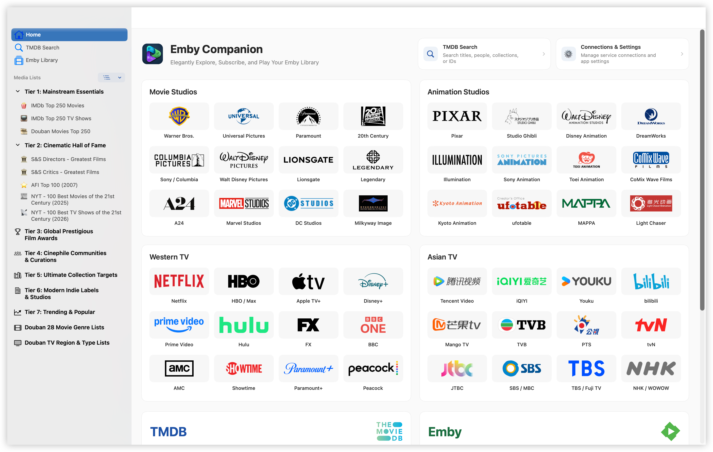
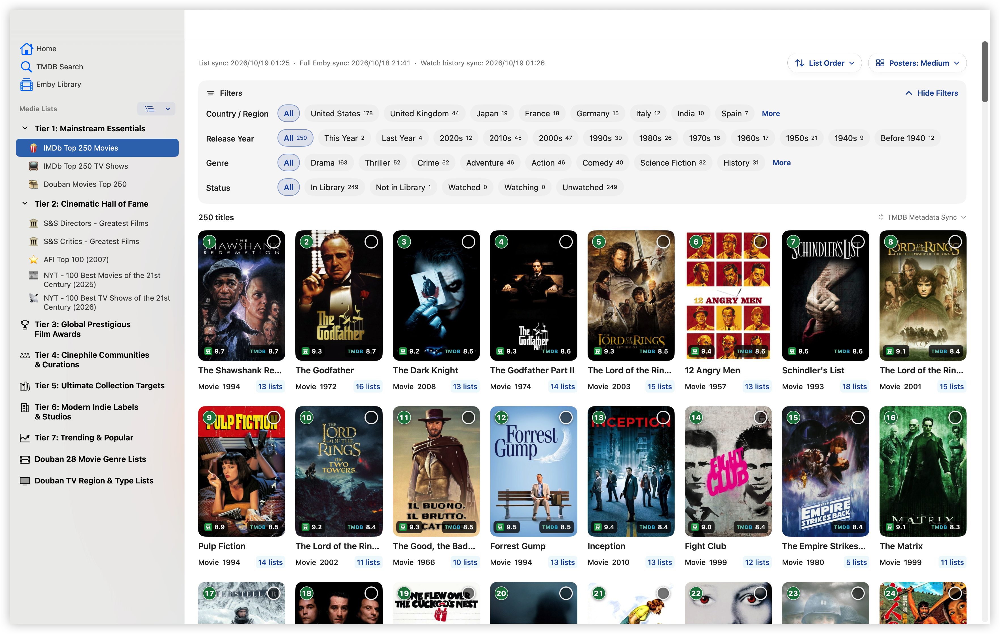

# Emby Companion

[简体中文](README.md) | [繁體中文](README.zh-TW.md) | **English**

---

**Elegantly Explore, Subscribe, and Play Your Emby Library**

Emby Companion is a macOS app that connects movie and TV lists, TMDB search, your Emby library, and MoviePilot subscriptions. Discover titles, check library availability, launch an external player, and sync playback progress from one app.

**An Emby server is optional.** Add your own TMDB API Key to browse lists and studio catalogs, search titles and people, and explore ratings, overviews, and filmographies. Library comparisons, missing-episode checks, and playback progress sync require an Emby connection.

[Download Latest](https://github.com/ffinly/emby-companion/releases/latest) · [Release History](https://github.com/ffinly/emby-companion/releases) · [Report an Issue](https://github.com/ffinly/emby-companion/issues)

This repository provides releases, documentation, and issue tracking. The app is closed source and does not provide media, server accounts, or third-party credentials.

## Interface Preview

*Home before configuring Emby. Connect and sync Emby to show your libraries; Continue Watching appears when resumable items are available.*

*Browse movie and TV lists, filter titles, and check availability in your Emby library.*

## Main Features

- **Home and Continue Watching:** Browse Emby libraries and resume the matching media version with your default player and route. Open the full view to see all entries.
- **Discover through lists:** Browse IMDb, Douban, TMDB, festival, and award lists with rankings and library status. See which lists include a title from its details. Presets follow [emby-collection-sync](https://github.com/ffinly/emby-collection-sync/blob/main/README.en.md); import online lists through “Add TMDB List.”
- **Studio discovery:** Explore titles from 48 studio and platform entries across Movie Studios, Animation Studios, Western TV, and Asian TV, with filters and library, watch, and subscription status.
- **Search titles and people:** Search by title, person, collection name, or ID, including TMDB and IMDb IDs and title links. Leave the title blank to browse popular titles in the selected region. Browse overviews, ratings, credits, and filmographies, with links to Douban, IMDb, and TMDB.
- **Browse your library:** Explore Emby movies, TV shows, collections, seasons, episodes, and playable versions. Manage watch states or temporarily hide watch history and progress.
- **Check availability and missing episodes:** Use synchronized Emby data to check library status and compare TMDB episode counts with actual Emby episode numbers by season. Unchecked seasons and unknown totals are identified separately. Checking missing episodes works without MoviePilot; subscribing requires it.
- **Core List Coverage:** Includes tiers 1–3 by default. Select tiers or include and exclude individual lists, then save to update deduplicated statistics. The home page's total unique titles and in-library count still cover all lists. You can also choose which list opens from Home.
- **MoviePilot integration:** Subscribe to missing movies or incomplete seasons, skipping available movies, complete seasons, and existing subscriptions. Search and manage subscriptions individually or in batches. MoviePilot is optional and handles downloads and library imports.
- **Multiple routes and external players:** Set separate synchronization and playback routes for the same Emby server. Choose a media version and launch SenPlayer, Infuse, or VidHub, with resume playback and progress callbacks. Split movies show labels such as `PART 1` and `DISC 2`, with matching files sorted numerically or alphabetically. Each part keeps its own progress; full-length versions still sync progress with one another.
- **Metadata and image caches:** A full library sync fetches TMDB title, person, and full-season episode metadata in your selected language. Images load on demand. Inspect sync results, retry failures, manage caches, or rebuild the local search index.
- **Backup and restore:** Choose configuration, lists, caches, and preferences for encrypted export and selective restore.

## Languages and Display

Set interface, preset list, TMDB metadata, and poster languages independently under “Connections & Settings → Language.” The interface supports System, Simplified Chinese, Traditional Chinese, and English. List and metadata languages can follow the interface or use any of the three languages independently.

List synchronization reads and caches upstream names in all three languages, so switching between cached names needs no new download. Title and person metadata, episode details, and titles shown in sync history follow the **TMDB Metadata Language**, with separate caches for each language. Available Emby data is retained when corresponding metadata is missing. Refreshing metadata updates local data only, leaving server metadata unchanged.

Posters can use the original language, Chinese, or English. Cached images are reused; uncached images still require a connection. Library name mapping supports Chinese–English presets and custom display names. Blank mappings keep the original name, and changes apply only within this app.

## Download and Get Started

Requires **macOS 14 or later**. Universal packages support **Apple Silicon and Intel**. Download the DMG from the [latest Release](https://github.com/ffinly/emby-companion/releases/latest) and drag **Emby Companion.app** to Applications. Quit the old version before replacing it.

### First Launch: macOS Security Prompts

The current package is locally signed and has no Apple Developer ID signature or notarization. After confirming it came from this repository's Releases, try opening it once. If blocked, go to **System Settings → Privacy & Security → Open Anyway** and follow the prompts. If macOS reports damage or malware, verify the source and report the exact message. See [Apple's guidance](https://support.apple.com/en-us/102445); later packages' signing status is listed in their Release notes.

### Connect Your Services

1. To use library features, enter your Emby address and sign in under “Connections & Settings.”
2. Request your own key in [TMDB API settings](https://www.themoviedb.org/settings/api), read the [API terms](https://www.themoviedb.org/api-terms-of-use), and enter the key in the app. Configure an HTTP or SOCKS proxy if needed for TMDB metadata, images, lists, and software updates from GitHub; Emby and MoviePilot connect directly.
3. Synchronize lists from Home. After connecting Emby, run “Full Library Sync.”
4. Install an external player if you want to play media. For subscriptions, also enter your MoviePilot address and API token, available under MoviePilot's “Settings → System → Basic Settings.”

TMDB and MoviePilot each offer “Clear configuration.” Clearing TMDB API settings keeps the proxy. Signing out of Emby clears its address, account, token, and all route settings.

## Routes and Players

After signing in, add and manage routes under “Connections & Settings → Emby → Multiple Connections.” Routes for the same server and account share the library cache. Set the main synchronization route and default playback route separately, or preview and import settings through an `ecplayer://importserver` link. See “Emby Routes → Import Emby from a Link” in the app for its format.

| External Player | Versions Supporting Progress Callbacks When the Playback Window Closes |
| --- | --- |
| SenPlayer | 6.1.1 or later |
| Infuse | 8.4.7 or later |
| VidHub | 2.3.5 or later |

Playback progress syncs automatically, with no switch to enable. **When you finish watching, close the playback window and wait for progress to sync before quitting the player. Quitting the player directly does not sync playback progress.** The app uses only the actual position returned by the player and never estimates progress without a valid callback. If a network error prevents synchronization, retry from the home page. Players must be installed separately.

Keep this app running during playback to maintain the Emby session and playback history. Closing this app’s window keeps heartbeats running; quitting this app or detecting that the player has exited stops them. Valid progress callbacks that arrive later can still be received.

Open “Connections & Settings → Playback → Playback Logs” to inspect player launches, heartbeats, callbacks, and synchronization. Filter, search, view records by playback request, or export `.log` files. Records and expanded ping details load automatically as you scroll. Successful pings are hidden by default and grouped in the full view. Logs stay on this device for up to seven days and 20,000 entries, excluding playback links and credentials.

## Software Updates

Check manually or enable automatic checking and downloading under “Connections & Settings → Software Update.” After verification, the update window guides installation and relaunch. Failed verification stops installation.

Multilingual release notes follow the current interface language. Older notes available in only one language retain their original text.

## Caches and Backups

“Connections & Settings” provides cache cleanup, local search index rebuilding, and encrypted backups. Clearing local caches does not delete Emby server content. Connection and sign-in information remain, and you can synchronize again afterward. “TMDB Cache Cleanup” can clear search result caches separately while keeping lists, library metadata, and images.

| Backup Component | Included Data |
| --- | --- |
| TMDB API Configuration | API address and API Key |
| MoviePilot API Configuration | Service address and API token |
| TMDB Lists | List contents, custom TMDB lists, list settings, and core list selection |
| TMDB Cache | Title and person metadata, posters, and person images |
| Emby Configuration | Server, routes, current account, sign-in token, and watch history |
| Emby Cache | Library, collections, episodes, and Emby images |
| Preferences | Languages, name mappings, player and display preferences |

Choose what to export, set a password of at least **eight characters**, and save the `.ecbackup` file. Choose the restore scope again when importing: configuration, lists, and preferences replace corresponding data, while caches are merged. Core list selection is included with “TMDB Lists.” Watch history is included with “Emby Configuration” for the current account only; restore checks the server and account and keeps newer records.

Backups may contain API keys and sign-in information. Keep the file and password secure.

## Privacy and Feedback

Connection information and caches are stored locally. Features send requests to your configured services, TMDB, and GitHub. GitHub list-definition and update requests do not include your TMDB API Key or Emby credentials.

When reporting issues, include the app version, macOS version, steps, and error message. Hide private addresses, accounts, keys, and other sensitive information in screenshots or logs.

## 📈 Star History

<a href="https://www.star-history.com/?repos=ffinly%2Femby-companion&amp;type=date&amp;legend=top-left">
  <picture>
    <source media="(prefers-color-scheme: dark)" srcset="https://api.star-history.com/chart?repos=ffinly/emby-companion&amp;type=date&amp;theme=dark&amp;legend=top-left" />
    <source media="(prefers-color-scheme: light)" srcset="https://api.star-history.com/chart?repos=ffinly/emby-companion&amp;type=date&amp;legend=top-left" />
    
  </picture>
</a>

## License and Third-Party Notices

See the [software license](LICENSE.txt) for the application's terms of use.

Rights to media content, metadata, images, likenesses, and third-party marks belong to their respective owners. The independent open-source components used by the app have their own licenses; see [Third-Party Notices](THIRD_PARTY_NOTICES.md). The app's license does not replace the terms of the services you use.

## TMDB Attribution

This product uses the TMDB API but is not endorsed or certified by TMDB.

[The Movie Database](https://www.themoviedb.org) · [API Terms of Use](https://www.themoviedb.org/api-terms-of-use)

The names and marks of Emby, MoviePilot, the players, and TMDB belong to their respective owners. This app is not affiliated with or endorsed by those services.
