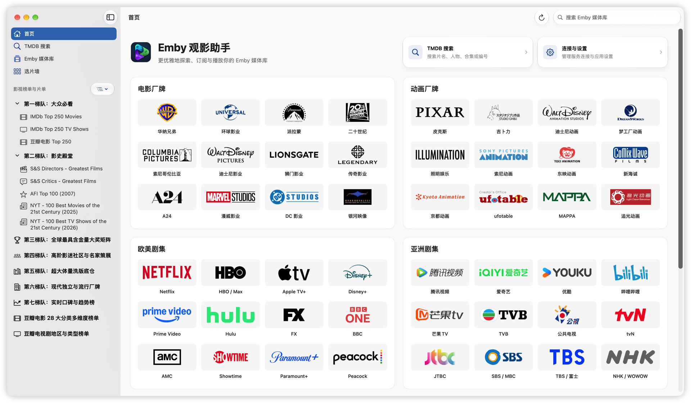
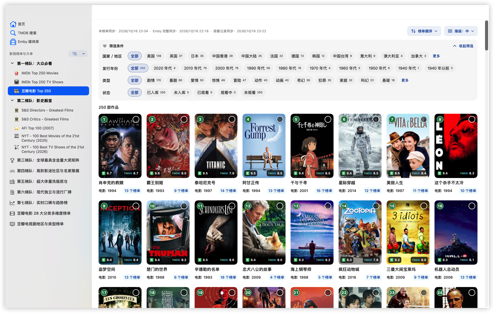
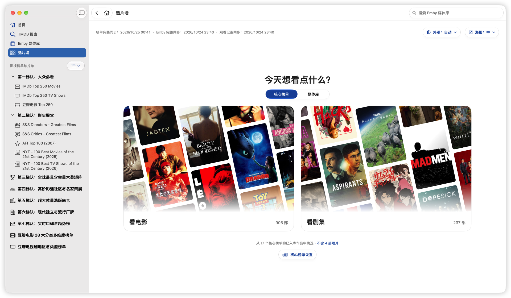

<p></p>

# Emby 观影助手

**简体中文** | [繁體中文](README.zh-TW.md) | [English](README.en.md)

---

**更优雅地探索、订阅与播放你的 Emby 媒体库**

Emby 观影助手是一款 macOS 观影工具。从榜单、厂牌和喜欢的演员、导演出发，找到下一部想看的电影或剧集；连接 Emby 后，直接核对入库与缺集，再用熟悉的播放器继续观看，进度自动同步回媒体库。

**没有 Emby 服务器也可以用。** 配置自己的 TMDB API Key，即可独立浏览榜单、探索 48 个厂牌与平台、搜索影视和人物，查看评分与简介。Emby 与订阅服务都可以按需连接。

[下载最新版](https://github.com/ffinly/emby-companion/releases/latest) · [版本记录](https://github.com/ffinly/emby-companion/releases) · [反馈问题](https://github.com/ffinly/emby-companion/issues)

本仓库提供安装包、使用说明与问题反馈；应用闭源，不提供影视资源、服务器账号或第三方服务凭证。

## 界面预览

截图展示 macOS 26 及以上的 Liquid Glass 外观，并随页面的浅色／深色主题自动切换；较早版本使用经典样式。

<picture>
  <source media="(prefers-color-scheme: dark)" srcset="assets/images/home.zh-CN.dark.png">
  <source media="(prefers-color-scheme: light)" srcset="assets/images/home.zh-CN.png">
  
</picture>

*首页厂牌探索。连接并同步 Emby 后可显示媒体库；有可续播记录时显示“继续观看”。*

<picture>
  <source media="(prefers-color-scheme: dark)" srcset="assets/images/poster-wall.zh-CN.dark.png">
  <source media="(prefers-color-scheme: light)" srcset="assets/images/poster-wall.zh-CN.png">
  
</picture>

*浏览影视榜单，筛选作品并查看 Emby 入库状态。*

<picture>
  <source media="(prefers-color-scheme: dark)" srcset="assets/images/what-to-watch.zh-CN.dark.png">
  <source media="(prefers-color-scheme: light)" srcset="assets/images/what-to-watch.zh-CN.png">
  
</picture>

*选片墙：从核心榜单或媒体库，挑选下一部想看的电影或剧集。*

## 主要功能

### 发现影视

- **选片墙**：连接 Emby、同步媒体库并补全库内 TMDB 资料后，从核心榜单已入库作品或整个媒体库挑选电影和剧集，支持未观看筛选、全屏海报墙及独立深浅色外观。合集同步和库外片单资料补全不影响进入。
- **榜单发现**：浏览 IMDb、豆瓣、TMDB、影展与奖项等榜单，查看排名和入库状态；从作品详情查看收录它的榜单。预置榜单随 [emby-collection-sync](https://github.com/ffinly/emby-collection-sync/blob/main/README.md) 更新，也可通过“添加 TMDB 片单”导入在线片单。
- **厂牌探索**：按电影厂牌、动画厂牌、欧美剧集和亚洲剧集浏览 48 个厂牌与平台的作品，支持作品筛选，展示入库、观看和订阅状态。
- **搜索与人物作品**：按片名、人物、合集名称或编号搜索，支持 TMDB／IMDb 编号及作品链接；片名留空可浏览所选地区的热门影视。查看作品宣传语、简介、评分、演职人员与人物作品集，详情页可就地展开演职人员的库内其他作品，也可跳转豆瓣、IMDb 和 TMDB。
- **核心榜单入库率**：默认统计第一至第三梯队，支持按级别选择、单独勾选或排除榜单，保存后更新去重统计。首页的全部片单作品数与已入库数量仍按所有片单统计。另可设置首页默认打开的榜单。

### 媒体库与播放

- **首页与继续观看**：首页浏览 Emby 媒体库与继续观看，使用默认播放器和线路续播对应版本，支持查看全部。
- **媒体库与合集**：浏览 Emby 电影、剧集、合集、季度与分集，支持电影／剧集／短片筛选，查看可播放版本并管理观看状态；在“设置 → 隐私”中可隐藏观看记录与进度，也可单独隐藏首页媒体库或“继续观看”。
- **剧集组**：有可用剧集组时，在剧集播放区域的季度菜单中查看自动推荐或手动切换，补全对应的分集标题和简介；季集编号与播放顺序保持不变。
- **入库与缺集核对**：根据已同步的 Emby 数据展示入库状态，按当前分季或剧集组核对缺季与缺集，并显示缺少的集号。尚未核对或总集数未知时单独提示。缺集核对无需配置 MoviePilot，订阅时才需要配置。
- **多线路与外部播放**：同一 Emby 服务器可分别配置资料同步与播放线路，选择媒体版本后调用 SenPlayer、Infuse 或 VidHub，支持续播与观看进度回传。同版本分段在版本列表和首页继续观看中合并显示，按 `PART 1`、`DISC 2` 等原文件标记选段续播，默认定位上次观看的分段，悬停可查看完整文件名；分段进度各自独立，普通完整版本间仍同步进度。

### 订阅、缓存与备份

- **MoviePilot 联动**：订阅未入库电影或缺集季度，自动跳过已入库、集数已齐及已有订阅的内容；支持搜索和批量管理订阅。MoviePilot 为可选服务，下载与入库由其处理。
- **资料与图片缓存**：同步片单与媒体库时自动补全所选语言的 TMDB 资料，供国家、类型筛选与作品详情使用；连接 Emby 后还会缓存人物及整季分集资料，图片按需加载。可查看同步结果、重试失败项，并管理缓存或重建本地搜索索引。
- **备份与恢复**：按需选择配置、片单、缓存及使用偏好，导出加密备份并选择恢复范围。

## 语言与显示

在“连接与设置 → 语言”分别设置界面、预置片单、TMDB 元数据及海报语言。界面支持跟随系统、简体中文、繁体中文与英文；片单和元数据可跟随界面，也可独立选择三种语言。

榜单同步会读取并缓存上游的三语名称，切换已有名称无需重新下载。影视与人物资料、分集信息及同步历史中的作品名称跟随 **TMDB 元数据语言**，不同语言资料分别缓存；缺少对应资料时保留可用的 Emby 内容。资料刷新只更新本机，不改写服务器元数据。

海报可选原语言、中文或英文。已有图片可复用，未缓存图片仍需联网。媒体库名称支持预置中英映射与自定义显示名称，留空保留原名称，仅影响本应用。

在“连接与设置 → 外观”选择外观模式（自动／浅色／深色，默认跟随系统）、调整海报大小，并在支持的系统上切换 Liquid Glass 与经典样式。

## 键盘快捷键（macOS）

| 快捷键 | 操作 |
| --- | --- |
| ⌘1 / ⌘2 / ⌘3 | 首页 / TMDB 搜索 / Emby 媒体库 |
| ⌘4 | 选片墙 |
| ⌘5 | 本次最后浏览的榜单或厂牌；没有记录时打开默认榜单 |
| ⌘6 | 订阅管理（需配置 MoviePilot） |
| ⌘, / ⌘R / ⌘F | 设置 / 刷新当前页面 / 搜索 |
| ⌘[ | 返回上一页；详情中关闭当前详情 |
| ⌘] | 前进到浏览历史中的下一页（有前进记录时可用） |
| 方向键 | 在作品与分集卡片间移动选择；预览打开时切换作品 |
| 空格 | 预览鼠标指向或键盘选中的作品；再按关闭 |
| 回车 | 打开完整详情；播放弹窗中执行当前选项 |
| Esc | 关闭当前预览、详情或播放弹窗；无浮层时清除选择 |
| Tab / Shift+Tab | 切换播放弹窗选项，也支持方向键和鼠标悬停选择；点空白可关闭弹窗 |

**全屏选片墙内**：P 暂停／继续漂移，D 切换深浅色；在墙面上按 Esc 后，3 秒内再按一次返回。

其他浏览页面中，海报和卡片下方文字均支持空格预览。滚动保留键盘选中项；选中卡片移出可视区域，或鼠标接管后重新开始键盘操作时，从当前完整可见的第一张开始。

输入框获得焦点时，方向键、空格、回车和 Esc 保持输入框的原有操作。⌘F 会全选已有搜索文字；回车提交搜索后释放输入焦点，不自动选中结果，按方向键才开始选择。

## 下载与初次使用

需要 **macOS 14 或更高版本**，通用安装包支持 **Apple Silicon 与 Intel**。从 [最新 Release](https://github.com/ffinly/emby-companion/releases/latest) 下载 DMG，将 **Emby Companion.app** 拖入“应用程序”；替换旧版前先退出应用。

### 首次打开：macOS 安全提示

当前安装包使用本地签名，尚未经过 Apple Developer ID 签名和公证。确认来源为本仓库 Releases 后，先尝试打开一次；如被系统阻止，前往 **系统设置 → 隐私与安全性 → 仍要打开**，按提示确认。参见 [Apple 官方说明](https://support.apple.com/zh-cn/102445)。

<details>
<summary>备用方法：通过终端处理首次打开限制</summary>

仅在确认安装包来自本仓库 Releases，并已将应用拖入“应用程序”后使用：

```bash
xattr -rd com.apple.quarantine "/Applications/Emby Companion.app"
```

若提示权限不足，可在命令前加上 `sudo`。

此命令移除应用的下载隔离属性，不能修复真正损坏的文件。若系统明确提示检测到恶意软件，请停止打开并反馈具体提示。

</details>

后续安装包的签名状态以 Release 说明为准。

### 首次配置

全新安装后，首页会显示“快速设置”，可直接完成基本配置或从备份恢复。已有配置的用户可从“连接与设置 → 关于应用 → 快速设置”重新打开。

1. **配置 TMDB API**：个人使用可免费申请自己的 API Key。展开“如何申请 API Key”，按步骤打开 [TMDB API 设置](https://www.themoviedb.org/settings/api)，阅读 [API 使用条款](https://www.themoviedb.org/api-terms-of-use)，将 **32 位 API Key（v3）**填入应用，再点“测试并保存”；不要填更长的 API Read Access Token。
2. **配置 Emby 服务器（可选）**：填写服务器地址、用户名和密码，点“登录并同步 Emby”。媒体库会在后台同步，无需 Emby Premiere；没有 Emby 可以跳过，仍可浏览榜单、搜索和厂牌。
3. **配置 MoviePilot 订阅（可选）**：填写服务地址和至少 **16 位**的 API 令牌，点“测试并保存”。令牌可从 MoviePilot“设定 → 系统 → 基础设置”复制；不用订阅可以跳过。跳过 Emby 时，这一步也会自动跳过。
4. TMDB 配置完成，且可选步骤已配置或跳过后，点“开始使用”。榜单与媒体库数据继续在后台同步；需要播放时，请另行安装下方支持的外部播放器。

TMDB 的 API 地址与图片地址通常保持默认，仅使用自建反向代理时修改。“TMDB 代理”仅用于 TMDB 资料、图片和片单；未启用时跟随系统代理。软件更新、Emby 与 MoviePilot 始终跟随系统代理。

TMDB 与 MoviePilot 可分别“清除配置”；清除 TMDB 配置需先退出 Emby，代理设置会保留。退出 Emby 会清除其地址、账号、令牌、线路及本机媒体库、专属图片和搜索索引，保留 TMDB 片单、共享缓存、MoviePilot 配置与应用偏好。尚未回传的播放进度单独保留，重新登录原服务器与账号后继续同步，不修改服务器上的媒体或观看记录。

<a id="zh-hans-emby-routes-and-players"></a>

## 线路与播放器

登录后，在“连接与设置 → Emby → 多线路管理”添加和管理线路。同一服务器与账号的多条线路共用媒体库缓存，可分别指定同步主线路与默认播放线路，也可通过 `ecplayer://importserver` 链接预览并导入配置。格式见应用内“Emby 线路 → 通过链接导入 Emby”。

| 外部播放器 | 支持关闭播放窗口后回传进度的版本 |
| --- | --- |
| SenPlayer | 6.1.1 及以上 |
| Infuse | 8.4.7 及以上 |
| VidHub | 2.3.5 及以上 |

播放进度自动同步，无需开启开关。**关闭播放窗口即可同步进度，请勿直接退出播放器。** 应用仅使用播放器回传的实际位置；未收到有效回调时不会推算进度，网络异常导致同步失败时可在首页重试。播放器需自行安装。

播放期间建议保持本程序运行，以维持 Emby 会话与播放历史。仅关闭本程序窗口不影响保活；完全退出本程序或检测到播放器退出后会停止保活，但仍可接收稍后到达的有效进度回调。

在“连接与设置 → 播放 → 查看播放日志”查看播放器调用、保活、回调与同步记录，支持筛选、搜索、按播放请求查看及导出 `.log`。记录与展开的 Ping 明细随滚动自动加载；成功 Ping 默认隐藏，在全部视图中合并显示。日志仅保存在本机，保留最近 7 天、最多 20,000 条，不记录播放链接与密钥。

## 软件更新

在“连接与设置 → 软件更新”手动检查更新，或启用自动检查与下载。下载显示进度，支持中断后续传；校验通过后由用户选择安装并重新启动，校验失败会停止安装。失败时可查看并复制本次更新的诊断详情。

支持多语言的升级日志随当前界面语言显示；旧版单语言日志保留原文。

## 缓存与备份

“连接与设置”提供缓存清理、本地搜索索引重建及加密备份。清理本地缓存不删除 Emby 服务器内容，连接与登录信息保留；之后可重新同步。“TMDB 缓存清理”可单独清除搜索结果缓存，保留片单、媒体库资料与图片。

| 备份内容 | 包含的数据 |
| --- | --- |
| TMDB API 配置 | API 地址、图片地址与 API Key |
| MoviePilot API 配置 | 服务地址与 API 令牌 |
| TMDB 榜单 | 榜单内容、自定义片单、片单设置与核心榜单范围 |
| TMDB 缓存 | 影视、分集、人物与剧集组资料及图片 |
| Emby 配置 | 服务器、线路、当前账号、登录令牌及观看记录 |
| Emby 缓存 | 媒体库、合集、分集、剧集组选择及 Emby 图片 |
| 使用偏好 | 语言、外观、播放与隐私偏好 |

导出时选择内容，设置至少 **8 个字符**的密码，保存为 `.ecbackup`；未配置服务对应的项目不可选择。恢复时可再次选择备份中包含的范围：配置、榜单与偏好替换对应内容，缓存合并。核心榜单配置随“TMDB 榜单”备份；观看记录随“Emby 配置”备份，仅包含当前账号，恢复时核对服务器与账号并保留较新的记录。

备份可能包含 API 密钥与登录信息，请妥善保管文件和密码。

## 隐私与反馈

连接信息与缓存保存在本机。应用根据功能向你配置的服务、TMDB 和 GitHub 请求数据；GitHub 榜单配置与更新请求不携带 TMDB API Key 或 Emby 登录凭证。

反馈时可在“连接与设置 → 关于应用”点“导出诊断信息”，附上生成的 `.txt` 文件、操作步骤及错误截图。诊断文件汇总版本、配置概况、缓存与同步状态、最近错误、更新诊断，以及最近最多 **10 次播放**的日志（连续成功 Ping 合并汇总），不发起新的网络请求。

诊断文件自动隐藏服务器地址、账号、凭据、文件路径及作品编号，作品标题替换为同一文件内一致的代号；文字跟随导出时的界面语言。应用内播放日志及其单独导出仍保留真实标题，分享这些日志或截图前，请自行隐藏观看内容与私人信息。

## 📈 Star History

<a href="https://www.star-history.com/?repos=ffinly%2Femby-companion&amp;type=date&amp;legend=top-left">
  <picture>
    <source media="(prefers-color-scheme: dark)" srcset="https://api.star-history.com/chart?repos=ffinly/emby-companion&amp;type=date&amp;theme=dark&amp;legend=top-left" />
    <source media="(prefers-color-scheme: light)" srcset="https://api.star-history.com/chart?repos=ffinly/emby-companion&amp;type=date&amp;legend=top-left" />
    
  </picture>
</a>

## 许可与第三方说明

软件使用条款见[使用许可](LICENSE.txt)。

影视内容、资料、图片、人物肖像及第三方标识的权利归各自权利人所有。应用使用的独立开源组件适用各自许可，详见 [第三方说明](THIRD_PARTY_NOTICES.md)。本软件的使用许可不替代相关服务的使用条款。

## TMDB 署名

<a href="https://www.themoviedb.org"></a>

本产品使用 TMDB API，但未经 TMDB 认可或认证。

This product uses the TMDB API but is not endorsed or certified by TMDB.

[The Movie Database](https://www.themoviedb.org) · [API 使用条款](https://www.themoviedb.org/api-terms-of-use)

Emby、MoviePilot、各播放器及 TMDB 的名称和标识归各自权利人所有。本应用与这些服务的运营方无隶属或认证关系。
