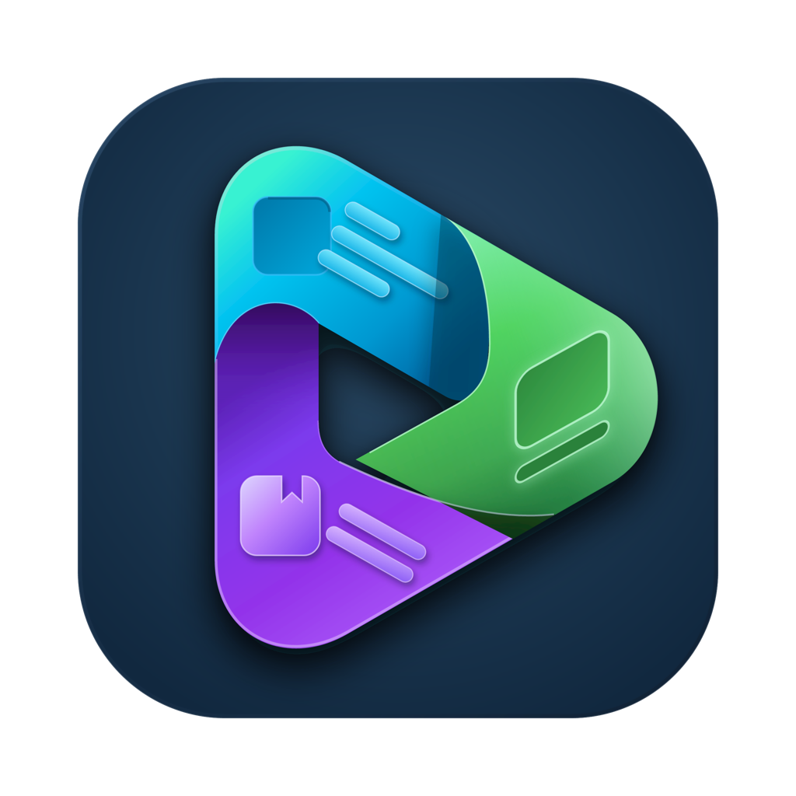
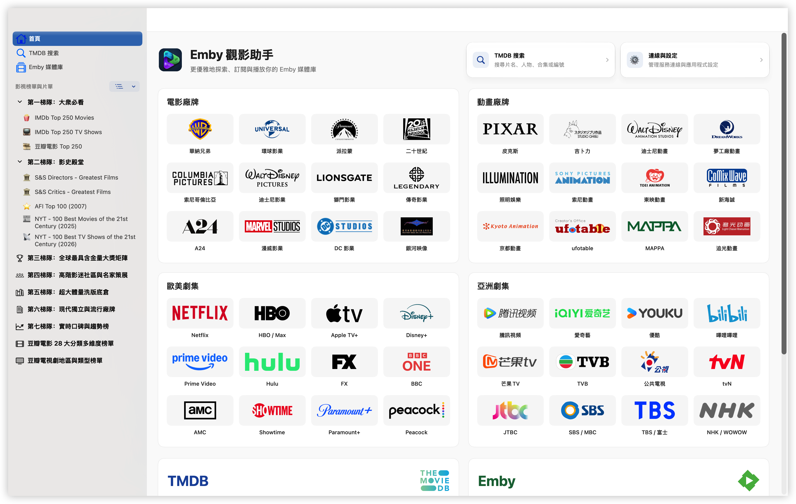
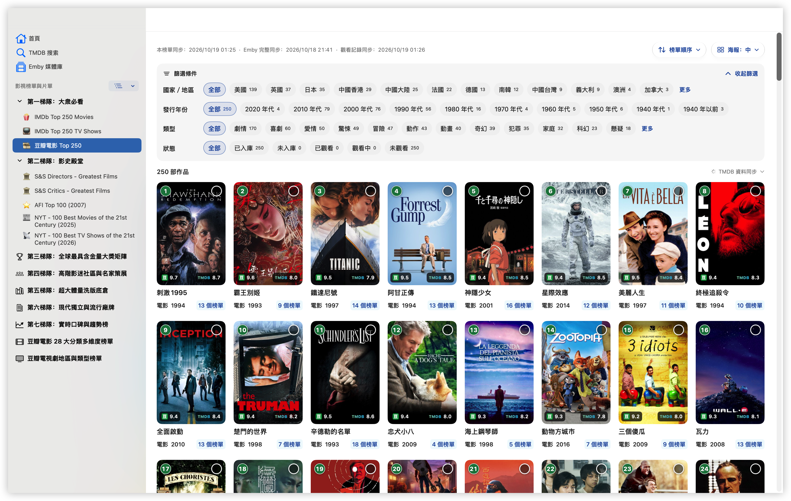

<p></p>

# Emby Companion

[简体中文](README.md) | **繁體中文** | [English](README.en.md)

---

**更優雅地探索、訂閱與播放你的 Emby 媒體庫**

Emby 觀影助手是一款 macOS 觀影工具。從榜單、廠牌和喜歡的演員、導演出發，找到下一部想看的電影或劇集；連線 Emby 後，直接核對入庫與缺集，再用熟悉的播放器繼續觀看，進度自動同步回媒體庫。

**沒有 Emby 伺服器也可以使用。** 設定自己的 TMDB API Key，即可獨立瀏覽榜單、探索 48 個廠牌與平台、搜尋影視和人物，查看評分與簡介。Emby 與訂閱服務都可依需求連線。

[下載最新版](https://github.com/ffinly/emby-companion/releases/latest) · [版本記錄](https://github.com/ffinly/emby-companion/releases) · [回報問題](https://github.com/ffinly/emby-companion/issues)

本儲存庫提供安裝包、使用說明與問題回報；應用程式閉源，不提供影視資源、伺服器帳號或第三方服務憑證。

## 介面預覽

截圖展示 macOS 26 及以上的 Liquid Glass 外觀；較早版本使用經典樣式。

<picture>
  <source media="(prefers-color-scheme: dark)" srcset="assets/images/home.zh-TW.dark.png">
  <source media="(prefers-color-scheme: light)" srcset="assets/images/home.zh-TW.png">
  
</picture>

*首頁廠牌探索。連線並同步 Emby 後可顯示媒體庫；有可續播記錄時顯示「繼續觀看」。*

<picture>
  <source media="(prefers-color-scheme: dark)" srcset="assets/images/poster-wall.zh-TW.dark.png">
  <source media="(prefers-color-scheme: light)" srcset="assets/images/poster-wall.zh-TW.png">
  
</picture>

*瀏覽影視榜單，篩選作品並查看 Emby 入庫狀態。*

## 主要功能

### 發現影視

- **榜單探索**：瀏覽 IMDb、豆瓣、TMDB、影展與獎項等榜單，查看排名和入庫狀態；從作品詳情查看收錄它的榜單。預設榜單隨 [emby-collection-sync](https://github.com/ffinly/emby-collection-sync/blob/main/README.zh-TW.md) 更新，也可透過「新增 TMDB 片單」匯入線上片單。
- **廠牌探索**：按電影廠牌、動畫廠牌、歐美劇集和亞洲劇集瀏覽 48 個廠牌與平台的作品，支援作品篩選，顯示入庫、觀看和訂閱狀態。
- **搜尋與人物作品**：按片名、人物、合集名稱或編號搜尋，支援 TMDB／IMDb 編號及作品連結；片名留空可瀏覽所選地區的熱門影視。瀏覽簡介、評分、演職人員與人物作品集，詳情頁可前往豆瓣、IMDb 和 TMDB。
- **核心榜單入庫率**：預設統計第一至第三梯隊，支援按級別選擇、個別勾選或排除榜單，儲存後更新去重統計。首頁的全部片單作品數與已入庫數量仍按所有片單統計。另可設定首頁預設開啟的榜單。

### 媒體庫與播放

- **首頁與繼續觀看**：首頁瀏覽 Emby 媒體庫與繼續觀看，使用預設播放器和線路續播對應版本，支援查看全部。
- **媒體庫與合集**：瀏覽 Emby 電影、劇集、合集、季度與分集，查看可播放版本，管理觀看狀態；可隱藏觀看記錄與進度，也可單獨隱藏首頁媒體庫或「繼續觀看」。
- **入庫與缺集核對**：根據已同步的 Emby 資料顯示入庫狀態，並按季度對照 TMDB 集數與 Emby 實際集號。尚未核對或總集數未知時會另行提示。缺集核對無需設定 MoviePilot，訂閱時才需要設定。
- **多線路與外部播放**：同一 Emby 伺服器可分別設定資料同步與播放線路，選擇媒體版本後呼叫 SenPlayer、Infuse 或 VidHub，支援續播與觀看進度回傳。分段電影以 `PART 1`、`DISC 2` 等標籤標示，同組檔案按數字或字母順序排列；分段檔案進度各自獨立，普通完整版本之間仍同步進度。

### 訂閱、快取與備份

- **MoviePilot 整合**：訂閱未入庫電影或缺集季度，自動略過已入庫、集數已齊及已有訂閱的內容；支援搜尋和批次管理訂閱。MoviePilot 為選用服務，下載與入庫由其處理。
- **資料與圖片快取**：完整同步媒體庫後自動取得所選語言的 TMDB 影視、人物及整季分集資料，圖片按需載入；可查看同步結果、重試失敗項目，並管理快取或重建本機搜尋索引。
- **備份與還原**：按需選擇設定、片單、快取及使用偏好，匯出加密備份並選擇還原範圍。

## 語言與顯示

在「連線與設定 → 語言」分別設定介面、預設片單、TMDB 中繼資料及海報語言。介面支援跟隨系統、簡體中文、繁體中文與英文；片單和中繼資料可跟隨介面，也可獨立選擇三種語言。

榜單同步會讀取並快取上游的三語名稱，切換已有名稱無需重新下載。影視與人物資料、分集資訊及同步歷史中的作品名稱跟隨 **TMDB 中繼資料語言**，不同語言資料分別快取；缺少對應資料時保留可用的 Emby 內容。資料重新整理只更新本機，不改寫伺服器中繼資料。

海報可選原語言、中文或英文。已有圖片可重複使用，未快取圖片仍需連線。媒體庫名稱支援預設中英對照與自訂顯示名稱，留空保留原名稱，僅影響本應用程式。

在「連線與設定 → 外觀」調整海報大小，並在支援的系統上切換 Liquid Glass 與經典樣式。

## 下載與初次使用

需要 **macOS 14 或更新版本**，通用安裝包支援 **Apple Silicon 與 Intel**。從 [最新 Release](https://github.com/ffinly/emby-companion/releases/latest) 下載 DMG，將 **Emby Companion.app** 拖入「應用程式」；取代舊版前先結束應用程式。

### 首次開啟：macOS 安全提示

目前安裝包使用本機簽署，尚未經過 Apple Developer ID 簽署和公證。確認來源為本儲存庫 Releases 後，先嘗試開啟一次；如遭系統阻擋，前往 **系統設定 → 隱私權與安全性 → 強制打開**，依提示確認。參見 [Apple 官方說明](https://support.apple.com/zh-tw/102445)。

<details>
<summary>備用方法：透過終端機處理首次開啟限制</summary>

僅在確認安裝包來自本儲存庫 Releases，並已將應用程式拖入「應用程式」後使用：

```bash
xattr -rd com.apple.quarantine "/Applications/Emby Companion.app"
```

若提示權限不足，可在指令前加上 `sudo`。

此指令會移除應用程式的下載隔離屬性，無法修復真正損壞的檔案。若系統明確提示偵測到惡意軟體，請停止開啟並回報具體提示。

</details>

後續安裝包的簽署狀態以 Release 說明為準。

### 連線服務

1. 如需使用媒體庫功能，在「連線與設定」填入 Emby 位址並登入。
2. 在 [TMDB API 設定](https://www.themoviedb.org/settings/api) 申請自己的 API Key，閱讀 [API 使用條款](https://www.themoviedb.org/api-terms-of-use)，再填入應用程式；需要時可設定 HTTP／SOCKS 代理，用於 TMDB 資料、圖片、榜單及軟體更新（GitHub）；Emby 與 MoviePilot 直連。
3. 在首頁同步榜單；連線 Emby 後，再執行「完整同步媒體庫」。
4. 需要播放時安裝外部播放器；需要訂閱時，再填入 MoviePilot 服務位址與 API 權杖；權杖可從 MoviePilot「設定 → 系統 → 基本設定」複製。

TMDB 與 MoviePilot 支援獨立「清除設定」；清除 TMDB API 設定時保留代理。登出 Emby 會清空位址、帳號、權杖及全部線路設定。

<a id="zh-hant-emby-routes-and-players"></a>

## 線路與播放器

登入後，在「連線與設定 → Emby → 多線路管理」新增和管理線路。同一伺服器與帳號的多條線路共用媒體庫快取，可分別指定同步主線路與預設播放線路，也可透過 `ecplayer://importserver` 連結預覽並匯入設定。格式見應用程式內「Emby 線路 → 通過鏈接導入 Emby」。

| 外部播放器 | 支援關閉播放視窗後回傳進度的版本 |
| --- | --- |
| SenPlayer | 6.1.1 及以上 |
| Infuse | 8.4.7 及以上 |
| VidHub | 2.3.5 及以上 |

播放進度自動同步，無需開啟開關。**播放結束後，請先關閉播放視窗，待進度同步後再結束播放器。直接結束播放器無法同步播放進度。** 應用程式僅使用播放器回傳的實際位置；未收到有效回呼時不會推算進度，網路異常導致同步失敗時可在首頁重試。播放器需自行安裝。

播放期間建議保持本程式執行，以維持 Emby 工作階段與播放歷史。僅關閉本程式視窗不影響保活；完全結束本程式或偵測到播放器結束後會停止保活，但仍可接收稍後送達的有效進度回呼。

在「連線與設定 → 播放 → 播放日誌」查看播放器呼叫、保活、回呼與同步記錄，支援篩選、搜尋、按播放請求查看及匯出 `.log`。記錄與展開的 Ping 明細隨捲動自動載入；成功 Ping 預設隱藏，在全部檢視中合併顯示。日誌僅儲存在本機，保留最近 7 天、最多 20,000 筆，不記錄播放連結與金鑰。

## 軟體更新

在「連線與設定 → 軟體更新」手動檢查更新，或啟用自動檢查與下載。驗證通過後由更新視窗引導安裝並重新啟動；驗證失敗會停止安裝。

支援多語言的更新日誌隨目前介面語言顯示；舊版單語言日誌保留原文。

## 快取與備份

「連線與設定」提供快取清理、本機搜尋索引重建及加密備份。清理本機快取不刪除 Emby 伺服器內容，連線與登入資訊保留；之後可重新同步。「TMDB 快取清理」可單獨清除搜尋結果快取，保留片單、媒體庫資料與圖片。

| 備份內容 | 包含的資料 |
| --- | --- |
| TMDB API 配置 | API 位址與 API Key |
| MoviePilot API 配置 | 服務位址與 API 權杖 |
| TMDB 榜單 | 榜單內容、自訂 TMDB 片單、片單設定與核心榜單範圍 |
| TMDB 快取 | 影視與人物資料、海報和人物圖片 |
| Emby 配置 | 伺服器、線路、目前帳號、登入權杖及觀看記錄 |
| Emby 快取 | 媒體庫、合集、分集及 Emby 圖片 |
| 使用偏好 | 語言、外觀、播放與隱私偏好 |

匯出時選擇內容，設定至少 **8 個字元**的密碼，儲存為 `.ecbackup`。還原時可再次選擇範圍：設定、榜單與偏好取代對應內容，快取合併。核心榜單設定隨「TMDB 榜單」備份；觀看記錄隨「Emby 配置」備份，僅包含目前帳號，還原時核對伺服器與帳號並保留較新的記錄。

備份可能包含 API 金鑰與登入資訊，請妥善保管檔案和密碼。

## 隱私與回報

連線資訊與快取儲存在本機。應用程式根據功能向你設定的服務、TMDB 和 GitHub 請求資料；GitHub 榜單設定與更新請求不攜帶 TMDB API Key 或 Emby 登入憑證。

回報時請提供應用程式版本、macOS 版本、操作步驟及錯誤提示，並隱藏截圖或日誌中的位址、帳號、金鑰等私人資訊。

## 📈 Star History

<a href="https://www.star-history.com/?repos=ffinly%2Femby-companion&amp;type=date&amp;legend=top-left">
  <picture>
    <source media="(prefers-color-scheme: dark)" srcset="https://api.star-history.com/chart?repos=ffinly/emby-companion&amp;type=date&amp;theme=dark&amp;legend=top-left" />
    <source media="(prefers-color-scheme: light)" srcset="https://api.star-history.com/chart?repos=ffinly/emby-companion&amp;type=date&amp;legend=top-left" />
    
  </picture>
</a>

## 許可與第三方說明

軟體使用條款見[使用許可](LICENSE.txt)。

影視內容、資料、圖片、人物肖像及第三方標識的權利歸各自權利人所有。應用使用的獨立開源組件適用各自許可，詳見 [第三方說明](THIRD_PARTY_NOTICES.md)。本軟體的使用許可不替代相關服務的使用條款。

## TMDB 署名

<a href="https://www.themoviedb.org"></a>

本產品使用 TMDB API，但未經 TMDB 認可或認證。

This product uses the TMDB API but is not endorsed or certified by TMDB.

[The Movie Database](https://www.themoviedb.org) · [API 使用條款](https://www.themoviedb.org/api-terms-of-use)

Emby、MoviePilot、各播放器及 TMDB 的名稱和標識歸各自權利人所有。本應用與這些服務的運營方無隸屬或認證關係。
